# Trait & Multi-omics — LangGraph research prototype

An independent English-language app for asking which proteins are associated with
a continuous trait, exploring RNA expression/miRNA/DNA methylation evidence, and
running educational MR, regional colocalization, and GO-style enrichment.

**All inputs and identifiers are fictional. No TOPMed, Framingham, patient data,
real QTL resources, or real GO annotations are included.**

## Start

The project has its own Python environment. From this directory in PowerShell:

```powershell
.\start.ps1
```

Open **http://127.0.0.1:8512/**. The older age-protein app uses port 8511.
Keep the terminal open while using the app; Ctrl+C stops it.
On a fresh machine with Python 3.11+, first run `setup.ps1`. Alternatively:

```powershell
python -m venv .venv
.\.venv\Scripts\python.exe -m pip install -r requirements.txt
.\.venv\Scripts\python.exe -m streamlit run app.py --server.address 127.0.0.1 --server.port 8512
```

## First run: no API key needed

1. Leave **Guided demo (no API)** selected.
2. Click **Explore SBP · all modules**, or enter:
   `Find proteins associated with SBP and integrate all analyses.`
3. Review the trait, covariates, modules and FDR threshold.
4. Click **Run this analysis**.
5. Browse the six tabs, inspect candidate proteins and genetic regions, and
   download the ZIP containing results, report, plan, workflow and provenance.

HbA1c is also supported. In guided mode, the trait and supported adjustment clauses
are parsed locally. Defaults come from the sidebar; explicitly named modules are
added. This is a bounded parser, **not** a general-purpose LLM. Ambiguous blood
pressure, unknown covariates, exclusions, subgroups and unsupported methods are
rejected. Do not assume every unrecognized instruction is supported: always review
the resolved plan. Set thresholds and excluded modules in the sidebar.

## Optional OpenAI interpretation

Select **OpenAI API**, enter your own model ID and key, and allow the displayed
transmission scope. Model availability and API billing depend on your project.
No key is bundled or stored in source files. Only the question and allowed
configuration are sent, using structured outputs and `store=False`; matrices,
IDs, genetic statistics, and results stay local. Do not place individual data
in the question. `store=False` is not a promise about provider-level retention.
An API refusal, unavailable model, network or quota error does not fall back to
a fabricated plan. The statistical workflow and final report use local code.
Cloud LangSmith tracing is disabled around workflow invocation.

## LangGraph execution

```mermaid
flowchart TD
  START --> validate --> protein_association
  protein_association -->|hits| omics_start
  protein_association -->|no hits| empty_candidates
  omics_start --> expression
  omics_start --> mirna
  omics_start --> methylation
  expression --> genetic_resources
  mirna --> genetic_resources
  methylation --> genetic_resources
  genetic_resources --> mr
  genetic_resources --> coloc
  mr --> go
  coloc --> go
  go --> report
  empty_candidates --> report
  report --> verify --> END
```



Actual `StateGraph` branches fan out/fan in: all three omics nodes must finish
before the genetic resource step, and MR and coloc must both finish before GO.
Reducers merge disjoint result/status dictionaries and append execution records.
Unrequested modules return explicit skipped statuses. Missing molecular datasets
are not assessed, rather than being labeled negative. Missing genetic evidence
is recorded per candidate. No-hit runs retain the complete association table.
Changing settings invalidates the previous plan and outputs; a failed new request
also clears old outputs. State is in the Streamlit session; disk checkpoint/restart
recovery is not implemented. Downloads provide a reproducible run record.

## Simulation and statistical contract

- 600 independent participants; 60 proteins, 60 expression features, 24 miRNAs,
  120 CpGs. Continuous traits: SBP (mmHg) and HbA1c (percentage points).
- Default seed 2026. Several proteins share latent factors, so marginal hits can
  include correlated markers beyond the directly planted trait effects.
- Models: `trait ~ standardized feature + age + sex + BMI + site`; site is
  categorical. OLS with HC3 robust covariance and t-based intervals. Each feature
  is standardized in its complete-case sample. One model per feature, no joint
  protein selection. Minimum 50 complete samples; maximum 20% feature missingness;
  no imputation. Constant/rank-deficient features are explicitly skipped.
- Expression values are normalized artificial signals. CpG beta values are
  converted to M-values (`log2(beta/(1-beta))`), then standardized.
- Within each layer, all feature–trait tests are performed before filtering for
  protein candidates. Adjusted protein–feature associations are a separate family
  over all registered links in that layer. Their direction is descriptive, not
  mediation. All protein/gene/CpG/miRNA links are fictional annotation hypotheses.
- BH families are separate: all successfully tested proteins; all successfully
  tested features within each layer; all successfully tested registered links
  within each layer; successfully estimated candidate MR tests; all tested gene
  sets. Downstream candidate analyses are exploratory after protein screening,
  with no selection-adjusted confirmatory guarantee.
- Genetic studies are generated separately from the participant matrices. Each
  region has 101 SNPs and a known synthetic AR(1) LD matrix (rho=0.85).
  Coordinates use fictional `SIM_BUILD_1`. Studies and instruments are artificial;
  synthetic cohort results and genetic effects need not agree.
- MR: cis-pQTL P<=5e-8, F>=10, allele harmonization, drop palindromes, greedy LD
  pruning at r²<=0.001 using simulated LD. Single SNP: Wald ratio with independent
  exposure/outcome delta-method SE. Multiple SNPs: fixed-effect IVW under NOME,
  with Cochran Q. Effects: trait units per 1 SD protein. Sample overlap,
  pleiotropy, reverse causality, winner's curse and assay artifacts are not solved.
- Colocalization: **computed** Wakefield ABF H0–H4 enumeration in Python, not
  fabricated posterior labels and not a call to the R `coloc` package. Dense
  common aligned regional statistics are used, independently of MR selection.
  Quantitative prior SD=0.15*phenotype SD (protein SD=1; outcome SD estimated
  from the simulated cohort). p1=p2=1e-4, p12=1e-5; sensitivity at 1e-6 and
  1e-4. One causal variant per trait per region. No SuSiE or multiple-signal
  model. H4 is not a probability of a causal protein effect.
- GO: real hypergeometric over-representation mathematics, **fictional SIM_GO
  sets**, not actual GO. Background is the unique mapped genes of successfully
  tested proteins. All testable sets, including zero-overlap sets, enter BH.
  This first version enriches the protein discovery set only. It does not
  perform separate expression-set or MR-supported-set enrichment.
- Report is deterministically assembled from result tables. Verification checks
  counts, candidate IDs, normalized coloc posteriors and simulation labels;
  it is not a substitute for independent scientific review.

## Files

| File | Responsibility |
|---|---|
| `app.py` | English Streamlit UI and downloads |
| `planner.py` | Guided parser and optional structured OpenAI interpretation |
| `simulation.py` | Synthetic cohort, links, gene sets and genetic regions |
| `statistics_engine.py` | Association, MR, ABF colocalization and enrichment |
| `workflow.py` | Actual LangGraph state, branches and report validation |
| `demo.py` | Reproducible input/result export without the UI |
| `test_project.py`, `test_ui.py` | Scientific, workflow and interaction tests |
| `requirements.lock.txt` | Exact installed package versions for this build |

Generate inputs and a complete example analysis:

```powershell
.\.venv\Scripts\python.exe demo.py --export-inputs
```

Inputs are in `demo_data/`; results are in `outputs/example_SBP/`. Optional:
`demo.py --trait HbA1c --output outputs/example_HbA1c`.

Run the checks:

```powershell
.\.venv\Scripts\python.exe -m unittest discover -v
.\.venv\Scripts\python.exe -m pip check
```

Real-data upload, binary/survival outcomes, family models, actual regulatory/GO
databases, eQTL/meQTL MR and coloc, multi-step mediation and clinical deployment
are outside this demonstration. No analysis uses personal or clinical data.

## Method references

- [LangGraph workflows](https://docs.langchain.com/oss/python/langgraph/workflows-agents)
- [OpenAI structured outputs](https://developers.openai.com/api/docs/guides/structured-outputs)
- [TwoSampleMR allele harmonization](https://mrcieu.github.io/TwoSampleMR/reference/harmonise_data.html)
- [coloc H0–H4 enumeration](https://chr1swallace.github.io/coloc/articles/a03_enumeration.html)
- [coloc dense regional data requirements](https://chr1swallace.github.io/coloc/articles/a02_data.html)
- [GO enrichment and background](https://www.geneontology.org/docs/go-enrichment-analysis/)
